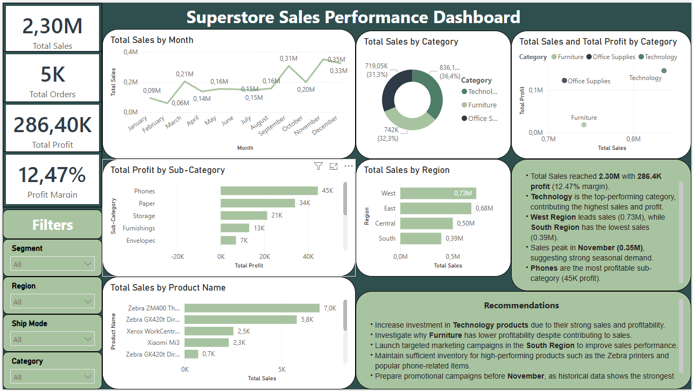

# 📊 Superstore Sales Performance Dashboard

## 📌 Project Overview

This project analyses Superstore sales data to identify revenue trends, top-performing products, profitable categories and regional sales performance. The dashboard was developed as part of the Future Interns Data Science & Analytics Internship (Task 1).

The objective is to turn raw sales data into clear business insights that support data-driven decision-making.

---

## 🎯 Project Objectives

- Analyse overall sales and profit performance
- Identify top-performing product categories
- Evaluate regional sales performance
- Track monthly sales trends
- Discover the most profitable products and sub-categories
- Generate actionable business recommendations

---

## 🛠 Tools Used

- Power BI
- Microsoft Excel
- Data cleaning and transformation
- DAX measures

---

## 📈 Dashboard KPIs

- Total Sales: **2.30M**
- Total Orders: **5K**
- Total Profit: **286.40K**
- Profit Margin: **12.47%**

---

## 📊 Dashboard Features

### Sales Trend Analysis

- Monthly sales performance visualisation
- Identification of peak and low sales periods

### Category Performance

- Total sales by category
- Sales vs profit comparison

### Regional Analysis

- Sales performance across regions
- Best and worst performing regions

### Product Analysis

- Top-selling products
- Most profitable sub-categories

### Interactive Filters

Users can filter the data by:

- Segment
- Region
- Ship Mode
- Category

---

## 🔍 Key Insights

- Total sales reached **2.30M** with **286.4K** profit.
- **Technology** is the highest-performing category in terms of sales and profit.
- The **West** region generated the highest sales.
- The **South** region recorded the lowest sales.
- Sales peaked in **November**, indicating strong seasonal demand.
- **Phones** emerged as the most profitable sub-category.

---

## 💡 Recommendations

1. Increase investment in Technology products because of their strong profitability.
2. Investigate the factors affecting Furniture profitability.
3. Run targeted marketing campaigns in the South region.
4. Maintain inventory levels for high-demand products.
5. Launch promotional campaigns before November to maximise seasonal sales.

---

## 📷 Dashboard Preview



---

## 📂 Repository Structure

```
FUTURE_DS_01
│
├── README.md
├── Sample - Superstore_.xlsx   (dataset)
├── Superstore.pbix             (Power BI dashboard)
└── dashboard.png               (dashboard screenshot)
```

---

## 🚀 Skills Demonstrated

- Data cleaning
- Data visualisation
- Business analytics
- KPI analysis
- Dashboard design
- Insight generation
- Power BI
- DAX

---

## 👩‍💻 Author

**Cesky Fhulufhelo Nengudza**
BSc Applied Mathematics, Walter Sisulu University

Email: ceskyakeelah@gmail.com
LinkedIn: [linkedin.com/in/cesky-nengudza-679bb4417](https://www.linkedin.com/in/cesky-nengudza-679bb4417)

---

## 🏆 Future Interns – Data Science & Analytics

Task 1: Business Sales Performance Analytics

This project demonstrates how data analytics techniques can be applied to business problems through interactive dashboard development and insight generation.
